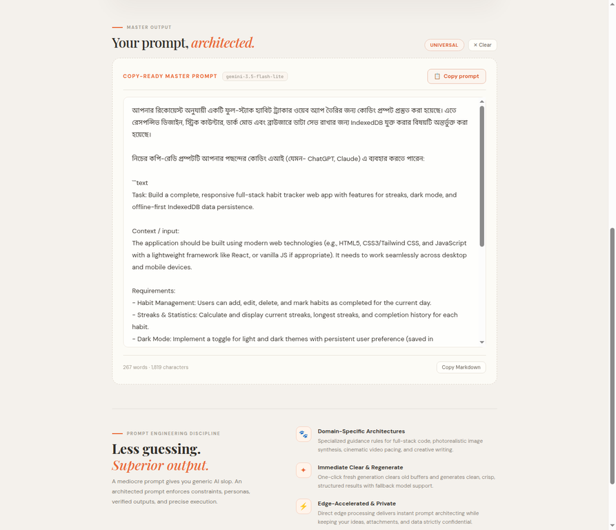
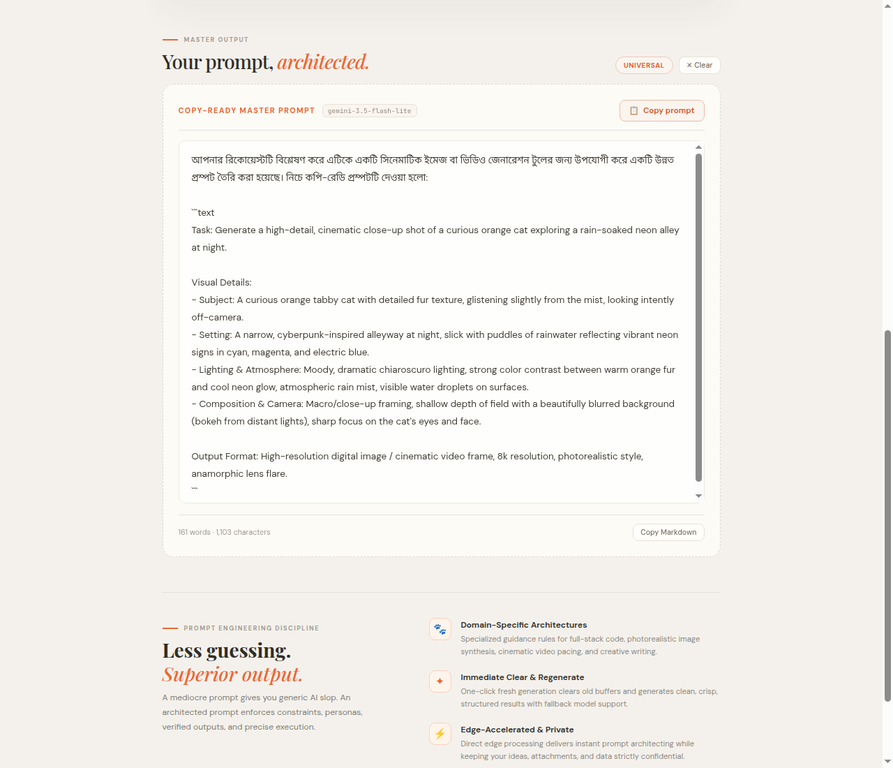

<div align="center">

# 🐾 Meaw Generator

### Rough idea. **Clear prompt.**

A little prompt architect that turns your thoughts into focused, copy-ready instructions for AI.

<a href="https://meawpromt.pages.dev"></a>
<a href="https://github.com/Quincunx33/Extender"></a>

<br>

*Small idea in. Sharper prompts out. Meow included.*

</div>

---

## A peek inside

<div align="center">
<a href="docs/prompt-example.webp"></a>
<a href="docs/cinematic-cat.webp"></a>
</div>

## Made for the next good idea

- **Prompt crafting** for code, images, stories, video, and more.
- **Reference media** support to give your idea extra context.
- **History and one-click copy** so useful prompts are easy to revisit and use.
- **A little feline charm** with an animated cat mascot and meow sounds.
- **Server-side Gemini integration** to keep API credentials out of the browser.

## Quick start

```bash
npm install
cp .env.example .env
```

Add your `GEMINI_API_KEY` to `.env`, then start the local server:

```bash
npm run dev
```

Open the local URL printed by the dev server. Create a production build with `npm run build`.

## Deploy

Deploy to **Cloudflare Pages** using `npm run build` as the build command and `dist` as the output directory. Set `GEMINI_API_KEY` as a Pages environment secret.

---

<div align="center">

[Live site](https://meawpromt.pages.dev) · [GitHub repository](https://github.com/Quincunx33/Extender)

<sub>Made with curiosity, prompts, and paws.</sub>

</div>
